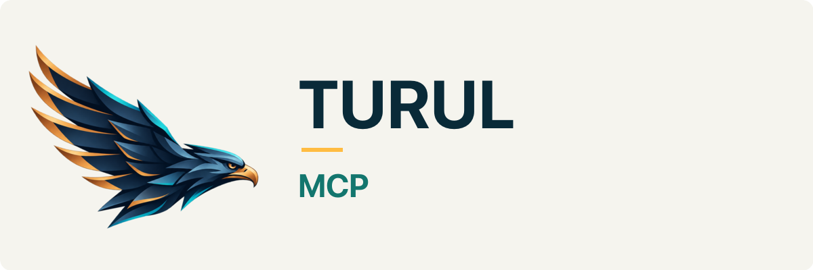

# Turul brand assets

Shared identity for the Aussie Robots Turul family.

## Assets

- The simplified bird is the shared project logo adaptation.
- The detailed source cutout is reserved for large illustrations.
- Each project has light/dark PNG lockups and a 1280×640 social preview.
- SVG layouts contain an embedded raster bird and editable text; they are not fully vector logos. PNG exports are the reference for exact typography.
- Project folders: mcp, a2a, llm, agent-skills, rpc, jwt.

Keep the bird shape and colours consistent. Select the light or dark lockup for the display background. Repository social previews must be configured separately in GitHub settings.

## Rights

Copyright © 2026 Toast Technology Pty Ltd. All rights reserved pending a separate policy. See [ARTWORK-NOTICE.md](ARTWORK-NOTICE.md). These terms apply to artwork, separately from Turul software licences.
